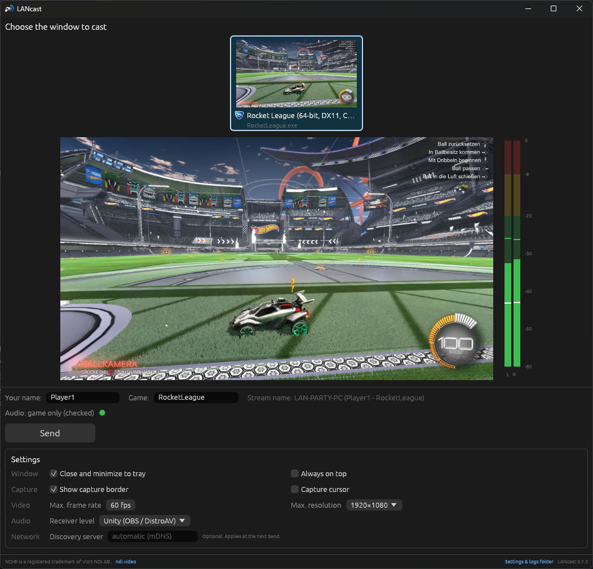

# LANcast

**Cast your game to the big screen at a LAN party: one window, the picture and only the game's sound, as an NDI® source on the local network.**



## Idea and motivation
At a LAN party everybody wants to show their game on the projector: a tournament final, a speedrun, a funny moment. The usual setups are clumsy:
- **HDMI cables** across the hall don't scale.
- **OBS on every participant's PC** means installation, configuration and a lot of support at the event.
- **Desktop capture** shows notifications, chat windows and other private things.
- **System audio** leaks everybody's Discord voice chat onto the PA.

LANcast is the participant's side of a simpler setup:
1. **Start one exe, pick the game, click "Send".** No configuration needed.
2. Only **that window** is captured: no desktop, no notifications.
3. Only **that game's audio** is sent: Discord, music and system sounds stay private.
4. The stream appears on the LAN as `PC-NAME (Player - Game)`. The central PC (OBS with the DistroAV plugin, NDI Studio Monitor, …) picks it from a list and puts it on the projector.

## Features
- **Window picker like Alt-Tab:**
  - a carousel with live thumbnails, which scrolls with the mouse wheel and can be dragged with mouse or touch
  - locked with a "LIVE" marker while casting
- **Live preview and audio meter** (OBS-style peak/RMS) before and while sending.
- **Game audio only** via WASAPI process loopback.
  - If Windows can't do that, LANcast warns *before* sending and asks: "Send with system audio" or "Send without audio".
- **Tray icon** with a red REC dot while casting. Optionally, close and minimize go to the tray, as long as the icon can be reached: on the taskbar or under the **^** arrow. If Windows hides it completely, × quits and minimize stays on the taskbar.
- **Stream name `Hostname (User - Game)`:** the user name defaults to the Windows login and is editable.
- **Network help:**
  - automatic discovery (mDNS)
  - an optional NDI Discovery Server
  - a warning if a stale discovery server is configured in NDI Access Manager
- **Remembers** settings, window size and position, and the game name per game.
- **Update check** at startup (can be turned off): LANcast looks for a newer release of its own edition. An installed LANcast updates with one click (it runs the new setup and restarts); a portable copy links to the download. Without a connection LANcast starts normally.
- **Anti-cheat friendly:** no injection, no hooks, no overlays in the game process. Only Windows APIs:
  - Windows Graphics Capture
  - WASAPI
  - DWM thumbnails

## How it works
```
┌──────────── LANcast.exe (participant PC) ─────────────┐         ┌── central PC ──────────┐
│ Windows Graphics Capture ──► scale/pace ─┐            │  NDI    │ OBS + DistroAV,        │
│  (one window, GPU → CPU)                 ├─► NDI send ─┼────────►│ NDI Studio Monitor,    │
│ WASAPI process loopback ──► 10 ms chunks ┘ (SpeedHQ)  │  LAN    │ … → projector / PA     │
│  (the game's process tree only)                       │         └────────────────────────┘
│ egui window + tray icon + controller thread           │
└───────────────────────────────────────────────────────┘
```
- **Video:**
  - Captured with [Windows Graphics Capture](https://learn.microsoft.com/en-us/uwp/api/windows.graphics.capture) via the `windows-capture` crate.
  - Paced to the frame-rate cap. A deadline pacer avoids the 48 fps trap on 144 Hz monitors.
  - Downscaled to the maximum resolution, then sent asynchronously as BGRX.
- **Audio:**
  - WASAPI **process loopback** (`AUDIOCLIENT_ACTIVATION_TYPE_PROCESS_LOOPBACK`, include process tree) via the `wasapi` crate.
  - 48 kHz stereo float in continuous 10 ms chunks; silence is filled in.
  - Falls back to system loopback only with the user's explicit consent.
- **NDI:**
  - The NDI 6 SDK via `grafton-ndi`, with one sender thread: video is clocked, audio is sent unclocked from the same thread.
  - Measured A/V offset: about +28 ms, i.e. audio slightly late, well below what people notice.
- **UI:**
  - [`eframe`/`egui`](https://github.com/emilk/egui) for the window.
  - DWM thumbnails (the Alt-Tab mechanism) for the carousel.
  - The tray is a small `Shell_NotifyIconW` module on its own thread.
  - A controller thread owns the session, so everything keeps working while the window is hidden.

The full specification is in [`docs/SPEC.md`](docs/SPEC.md). Every technical decision, with sources and measurements, is in [`docs/DECISIONS.md`](docs/DECISIONS.md). The icon is described in [`docs/ICON.md`](docs/ICON.md).

## Event links
Organizers can configure every participant's LANcast with one link on the event website:

```html
<a href="lancast://config?event=NetGame%202026&discovery=10.0.0.5&max=1280x720&fps=60&level=unity">
  Configure LANcast for NetGame 2026
</a>
```

| Key | Meaning |
|---|---|
| `event` | Event name, shown in the settings |
| `discovery` | The event's NDI Discovery Server ("gateway"), `host[:port]`; empty = automatic (mDNS) |
| `max`, `fps` | **Limits** that keep the network bandwidth in check; users can only choose lower values |
| `level`, `border`, `cursor` | **Defaults** (receiver audio level `unity`/`ndi`, capture border, cursor `1`/`0`) |

LANcast shows the settings and asks before applying them; a link never starts sending. Clicking the same link again doesn't ask again: LANcast only asks when the event or its enforced settings change. "Leave event" in the settings removes them again.

The installer registers the `lancast:` scheme and the uninstaller removes it; the ZIP version registers it on first start. *Settings → Links* shows which copy opens the links and can switch it to the current one, e.g. after moving the folder.

Full reference with all keys, encoding rules, a website template and testing tips: [`docs/EVENT_LINKS.md`](docs/EVENT_LINKS.md).

### Organizer and event editions ("LAN distro")
For events that want more control, there are editions of LANcast that **do not send until they have an event configuration signed by the organizer**:
- **Organizer edition** (the default, D35): one build for all of an organizer's events, e.g. *LANcast – netgame edition*. It comes without a configuration; participants get each event's configuration from a signed event link. Built once per release.
- **Event edition** (D28): one build for one event, with the configuration (`LANcast.event`) in the download.

How the configuration works:
- **Two sections.** The configuration has an *enforced* section (signed: discovery server, limits, anything else the event wants fixed) and a *defaults* section (unsigned starting values participants may change).
- **Delivery.** As a signed `lancast://event?…` link, or as `LANcast.event` next to the exe. It is valid from/until given dates.
- **Signing.** Ed25519: an edition contains only the organizer's public key, so a configuration can't be forged or changed, not even with the exe in hand.

`secret.key` is the organizer's private signing key. Keep it and the event files **outside the repository**, e.g. in `%USERPROFILE%\lancast-netgame\`, and back the key up in a password manager: an organizer key covers all events, and without it the organizer edition has to be replaced. Never commit it, and never put it into a download.

```powershell
cargo build --release --bin lancast-event
$dir = "$env:USERPROFILE\lancast-netgame"; mkdir $dir
# once per organizer: create the key pair (prints the public key)
target\release\lancast-event keygen $dir\secret.key
# per event: copy the template, adjust name, id, dates and settings, and sign it (prints the event link)
copy packaging\event.example.toml $dir\netgame-2026.toml
target\release\lancast-event sign $dir\netgame-2026.toml $dir\secret.key $dir\netgame-2026.event
```
The organizer edition comes with every release once the public key is set up (repository variables, see [Versions and releases](#versions-and-releases)); locally: `package.ps1 -Edition netgame -PublicKey <key>`. An event edition is built with `package.ps1 -EventConfig <event.toml> -SigningKey <secret.key>`, or for a released version with the *Event package* workflow. Details: [`docs/EVENT_LINKS.md`](docs/EVENT_LINKS.md#event-edition-lan-distro).

## Requirements
- **Windows 10 1903 or newer, 64-bit.** Windows 11 is recommended: process loopback (game-only audio) is documented from build 20348.
- Games should run in **borderless windowed** mode. Exclusive fullscreen may not be captured.
- **A receiver on the LAN:** OBS with [DistroAV](https://github.com/DistroAV/DistroAV), [NDI Tools](https://ndi.video/tools/) (Studio Monitor), or other NDI software.

## Using it
1. Download `LANcast-<version>-setup.exe` (installer) or `LANcast-<version>-win64.zip` (portable) from the [GitHub releases](https://github.com/netgame-switzerland/lancast/releases), then install or unzip it. At an event, the organizers may point you to their edition instead, e.g. `LANcast-<version>-netgame-setup.exe` (see [Organizer and event editions](#organizer-and-event-editions-lan-distro)).
   - With admin rights, the installer also adds the Windows Firewall rule; receivers connect to the sender.
2. Start LANcast, pick your game, check the preview and the meter, and click **Send**.
3. On the central PC, add the source `PC-NAME (Player - Game)`.

**Audio level tip:**
- OBS/DistroAV plays NDI audio 1:1.
- NDI Studio Monitor follows the NDI reference level and plays it 20 dB quieter. Set *Settings → Audio → Receiver level* to "NDI standard +20 dB" for it.

Participant-facing instructions (firewall, SmartScreen, troubleshooting) are in [`packaging/README.txt`](packaging/README.txt), which ships with the release.

## Building
**Prerequisites:**
- **Rust:** stable (edition 2024) with the MSVC toolchain (`x86_64-pc-windows-msvc`). Build natively on Windows, not in WSL.
- **[NDI 6 SDK](https://ndi.video/for-developers/ndi-sdk/):** the default path is `C:\Program Files\NDI\NDI 6 SDK`; otherwise set `NDI_SDK_DIR`.
- **LLVM/Clang** for bindgen (`winget install LLVM.LLVM`); set `LIBCLANG_PATH` if it's not found.
  - Both paths can be set in a local `.cargo/config.toml` (git-ignored) under `[env]`.
- **For packaging only:** Python 3 (third-party license list; Pillow for regenerating icons) and [Inno Setup 6](https://jrsoftware.org/isinfo.php) (`winget install JRSoftware.InnoSetup`).

**Build and check:**
```powershell
cargo build --release                         # target\release\LANcast.exe (+ NDI DLL copied next to it)
cargo clippy --all-targets -- -D warnings
cargo fmt
cargo test --release                          # unit tests (pacer, scaler, levels, config, links, signatures, tray, icons)
cargo deny check                              # advisories, licenses, sources (see Dependencies)
```
Quit a running LANcast before rebuilding: Windows does not let cargo replace a running exe.

**Other platforms:** LANcast ships for Windows only. The code is split into a portable core and Windows backends (D32), with stubs elsewhere. CI builds and tests it on Linux, but a Linux build can't capture anything yet.

**Local package (snapshot):**
```powershell
powershell -File tools\package.ps1   # dist\LANcast-<ver>-snapshot.g<hash>-win64.zip and …-setup.exe
```
With `-Edition <organizer> -PublicKey <key>` it also builds the organizer edition, with `-EventConfig event.toml -SigningKey secret.key` an event edition (see [Organizer and event editions](#organizer-and-event-editions-lan-distro)).

## Versions and releases
LANcast uses [Semantic Versioning](https://semver.org/): `MAJOR.MINOR.PATCH`, optionally with a pre-release suffix such as `1.0.0-rc.1`.
- **`Cargo.toml` holds the last released version**, and each release has the git tag `v<version>`. Don't change the version by hand; the release workflow does that.
- **Local builds are snapshots.** `build.rs` stamps them as `<version>+snapshot.g<commit>` (plus `.dirty` with uncommitted changes), e.g. `0.2.0+snapshot.g1a2b3c4`. The version is shown in the settings footer, in the log and in the exe's properties. Local packages are named `LANcast-0.2.0-snapshot.g1a2b3c4-…`.
- **Releases are built by GitHub Actions** with the plain version, e.g. `0.2.0`.

**Creating a release:** on GitHub, open *Actions → Release → Run workflow* on `main` and pick the bump (`patch`, `minor`, `major`), or enter an exact version. Use `none` to release the current `Cargo.toml` version as it is, if it has no tag yet. The workflow:
1. computes the new version and checks that its tag doesn't exist yet,
2. updates `Cargo.toml`/`Cargo.lock`, installs the latest NDI 6 SDK, runs clippy and the tests,
3. builds `LANcast-<ver>-win64.zip` and `LANcast-<ver>-setup.exe` (`tools\package.ps1 -Release`), the organizer edition if it is set up (below), plus `SHA256SUMS.txt` and the signed update manifest `LANcast-update.json`,
4. pushes the commit `Release v<ver>` and the tag `v<ver>` to `main`, but only if everything above succeeded,
5. publishes the GitHub release with the packages and generated release notes. A version with a suffix (`-rc.1`) becomes a pre-release.

**Update manifest:** LANcast checks `https://github.com/netgame-switzerland/lancast/releases/latest/download/LANcast-update.json` (`update_url` in `LANcast.toml` overrides it, e.g. for a mirror on the event LAN: the manifest and the packages in one folder). The manifest is signed with the release key; its public key is `UPDATE_KEY` in `src/update.rs`, the private key is the repository secret `UPDATE_SIGNING_KEY` (created with `lancast-event keygen`; keep a copy in a password manager). *Release* refuses to run without it. `releases/latest` skips pre-releases, so updates are only offered for full releases. See D37 in [`docs/DECISIONS.md`](docs/DECISIONS.md).

**Event edition of a release:** *Actions → Event package*, with the release tag and the name of a GitHub environment that holds the event's files. See [`docs/EVENT_LINKS.md`](docs/EVENT_LINKS.md#building-in-github-actions).

**Organizer edition in every release:** with the repository variables `ORGANIZER_EDITION` and `ORGANIZER_PUBLIC_KEY` set, *Release* also builds and attaches `LANcast-<ver>-<organizer>-win64.zip` and `…-setup.exe`. It needs no secret.

The *CI* workflow checks formatting, clippy, the tests and the dependencies on every push to `main` and on pull requests. Clippy and the tests also run on Linux, so the platform split keeps building there; there are no Linux packages yet. Run it manually (*Actions → CI → Run workflow*) to also get snapshot packages as a workflow artifact, without tagging or publishing anything.

## Dependencies
`Cargo.toml` lists the direct dependencies with compatible version ranges; the committed `Cargo.lock` pins the exact version of every crate in the tree, so all builds use the same code.
- **Updates:** Dependabot (`.github/dependabot.yml`) opens pull requests monthly: compatible crate updates grouped in one PR, updates that need code changes (e.g. eframe 0.37 → 0.38) separately, and GitHub Actions updates. CI checks each PR. Locally: `cargo update`.
- **Checks:** [`cargo-deny`](https://github.com/EmbarkStudios/cargo-deny) (`deny.toml`) fails CI on crates with a known security advisory ([RustSec](https://rustsec.org/)), with a license that isn't allowed (the exe and its license list ship to participants), or from a source other than crates.io. Locally: `cargo install cargo-deny --locked`, then `cargo deny check`.
- **Security alerts:** GitHub's Dependabot alerts (*Settings → Code security*) warn about new advisories for the pinned versions between updates.

## Testing
Unit tests cover the pure logic. Capture, audio and NDI are checked with small tools in `examples/`:

| Example | Purpose |
|---|---|
| `ndi_testpattern` | Sends colour bars plus a beep with a white flash marker, to check a receiver and lip sync. |
| `ndi_probe [name] [secs] [--av]` | A receiver: resolution, fps, audio rate and level. `--av` measures the flash→beep offset. |
| `av_sync_source [secs] [--silent]` | A test "game" window that flashes and beeps, for end-to-end lip-sync and isolation tests. |
| `list_windows` | Lists the capturable windows with HWND, PID and process. |
| `wgc_window <0xHWND\|PID>` | Captures one window and logs fps, size and readback cost. |
| `process_loopback <PID\|--system>` | Records a process's audio to a WAV file. |
| `tray_preview` | Renders all tray icon states into `docs/images/tray-states-4x.png`. |

Run them with `cargo run --release --example <name> -- <args>`.

**Typical end-to-end check:**
1. Run `av_sync_source 60`.
2. Start LANcast, pick that window and click Send.
3. Run `ndi_probe "av_sync_source" 15 --av`.

**Environment switches for tests and demos:**
- `LANCAST_SIMULATE_NO_PROCESS_LOOPBACK=1` makes process loopback fail, to exercise the Windows 10 warning path.
- `LANCAST_WINDOW_FILTER=Game.exe,Other.exe` restricts the window list, e.g. for screenshots without private windows.
- `LANCAST_LOG=debug` sets the log level.

**Command-line mode** (no window, useful for testing): `LANcast <0xHWND|PID> [--name N] [--fps N] [--max-size WxH] [--system-audio|--no-audio] …`. Run `LANcast --help` for the full list.

## Project layout
```
src/
  main.rs            entry point: GUI without arguments, CLI with arguments
  lib.rs             module list, VERSION; Windows-only modules swap to src/unsupported/ elsewhere
  cli.rs             command-line mode
  app/               egui UI, carousel, meter, controller thread
  capture/           pacer, scaler; video.rs (options, preview, FrameSink) with backend
                     video_wgc.rs (WGC); audio.rs (types, levels) with backend audio_wasapi.rs
  session.rs         one send session (NDI + video + audio) and the preview capture
  ndi_out.rs         NDI sender thread
  ndi_config.rs      NDI network configuration (discovery server)
  config.rs          LANcast.toml, data folder (%LOCALAPPDATA%\LANcast, portable mode)
  logging.rs         tracing to stdout and the log file
  os_caps.rs         OS build and optional capture features (process loopback, …)
  event_link.rs      lancast:// links: enforced and default sections
  url_scheme.rs      registration of the lancast: scheme
  distro.rs          organizer and event editions: signed event configurations (Ed25519)
  bin/lancast-event.rs  organizer tool: key, sign, verify
  tray.rs            tray states, commands, icon drawing; backend tray/win32.rs
                     (Shell_NotifyIconW, notifications, single instance)
  tray_visibility.rs whether the tray icon can be reached (D29)
  windows_list.rs    window list, filter, target resolution; backend windows_list/win32.rs
  win_thumbnail.rs   DWM live thumbnails
  app_icon.rs        LANcast's own icon for the window and the tray
  exe_icon.rs        icons of game executables for the carousel
  unsupported/       stubs of the Windows-only modules for other platforms (D32)
examples/            spikes and test tools (see above); Windows API code in examples/windows/
packaging/           README/EULA for the release, Inno Setup script, event.example.toml
tools/               package.ps1, make_icons.py, third_party_licenses.py
.github/             CI, release and event package workflows, Dependabot
deny.toml            cargo-deny: allowed licenses, advisories, sources
docs/                SPEC, DECISIONS, ICON, EVENT_LINKS
```

## License
LANcast is licensed under the [Apache License 2.0](LICENSE); see [`NOTICE`](NOTICE).

The release package also contains the NDI® runtime library. It is **not** covered by the Apache License and is subject to the NDI SDK license terms (see `packaging/EULA.txt` and `Processing.NDI.Lib.Licenses.txt`). Third-party crates and their licenses are listed in the generated `THIRD-PARTY-LICENSES.txt`.

NDI® is a registered trademark of Vizrt NDI AB. [ndi.video](https://ndi.video/)
