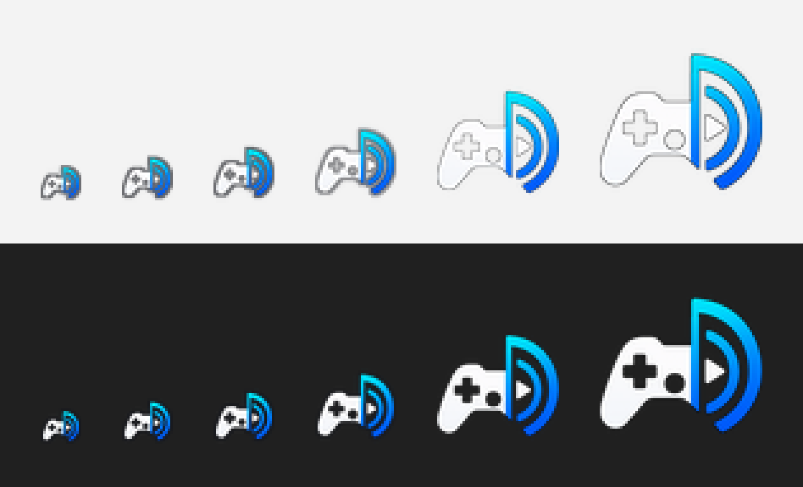
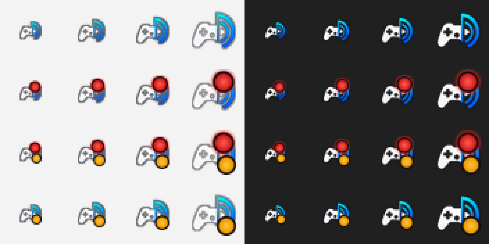

# LANcast icon

Design by Kay. The source is `assets/icon-source.png` (1000×1000, transparent background, with contour).

Actual size (16, 20, 24, 32, 48 and 64 px), as they appear in the tray, taskbar and Explorer:

## Tray states
Rows from the top: idle, casting (glowing red REC dot), casting with system audio (REC dot plus amber dot), and stopped unexpectedly (amber dot). Sizes 16–32 px on a light and a dark background, 4× enlarged. Generate it with `cargo run --release --example tray_preview`; the drawing is in `src/tray.rs` (`tray_icon_rgba`).

## How the sizes are made
`python tools/make_icons.py` (needs Pillow) generates everything from the source:

| Output | Used for |
|---|---|
| `assets/icon-16.png` … `icon-64.png` | Window icon and tray icon (embedded into the exe, `src/app_icon.rs`). The tray adds a state dot (green / amber / red). |
| `assets/LANcast.ico` (16–256 px) | Icon of `LANcast.exe`, embedded by `build.rs` via `winresource`. |
| `docs/images/icon-preview-*.png` | The previews on this page. |

Processing steps:
- **Crop.** The transparent margin is cropped, and the shape is centered in a square.
- **Sources without alpha.** The black background is made transparent by a flood fill from the corners.
- **16–32 px.** The source's contour is too thin to survive downscaling, and the white controller would vanish on light backgrounds. These sizes therefore get:
  - a 1 px dark outline (60 % opacity, 45 % at 32 px)
  - the shape shrunk by 2 px, so the outline is not cut off at the left and right edges
- **48 px and up** are plain downscales of the source.

After changing the source, run the script and rebuild. Explorer may show the old exe icon until the Windows icon cache refreshes.
